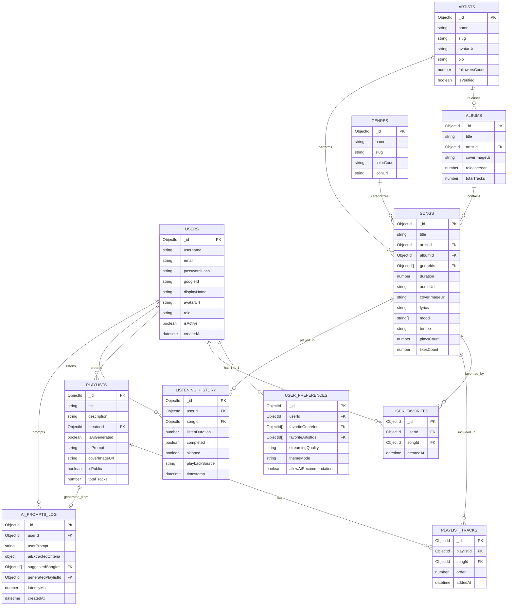

# TÀI LIỆU THIẾT KẾ CƠ SỞ DỮ LIỆU (DATABASE SPECIFICATION)
## DỰ ÁN: AI-POWERED MUSIC STREAMING APPLICATION (SPOTIFY CLONE)

---

> **Phiên bản:** 1.0.0  
> **Kiến trúc:** MongoDB (Modular 4-Tier Normalized Architecture) + Mongoose ODM  
> **Backend:** Node.js + Express.js  
> **Client:** Android Native (Java, MVVM, Room DB Offline Cache)  
> **Lưu trữ & Phân phối Media:** Node.js Express Static Streaming Server (/uploads/audios) & Google OAuth  
> **AI Engine:** Google Gemini API (Structured Criteria Recommendation & Playlist Generator)  

---

## 1. TỔNG QUAN KIẾN TRÚC CƠ SỞ DỮ LIỆU (4-TIER ARCHITECTURE)

Hệ thống cơ sở dữ liệu được thiết kế theo mô hình **4 phân hệ độc lập (4-Tier Modular Architecture)** nhằm tối ưu hóa khả năng mở rộng (scalability), đảm bảo tính toàn vẹn dữ liệu (data integrity) và đáp ứng truy vấn streaming thời gian thực với độ trễ thấp (<50ms):

```
┌────────────────────────────────────────────────────────────────────────┐
│                        MONGODB DATABASE (MUSIC APP)                    │
├────────────────────────────────────────────────────────────────────────┤
│ 1. MUSIC CATALOG MODULE                                                │
│    ├── artists           (Danh ca sĩ, ban nhạc, xác thực)             │
│    ├── albums            (Album phát hành, liên kết ca sĩ)             │
│    ├── genres            (Thể loại nhạc, mã màu theme VibeTune)        │
│    └── songs             (Bài hát, audio URL, lyrics, mood, vector 768)│
├────────────────────────────────────────────────────────────────────────┤
│ 2. USER & INTERACTION MODULE                                           │
│    ├── users             (Tài khoản người dùng, phân quyền RBAC)       │
│    ├── user_preferences  (Gu âm nhạc 1-1, cấu hình phát nhạc)         │
│    ├── user_favorites    (Junction table: danh sách bài hát yêu thích) │
│    ├── user_interactions (Tín hiệu tương tác chi tiết cho recommender)│
│    └── otp_verifications (Xác thực OTP số điện thoại đăng nhập)        │
├────────────────────────────────────────────────────────────────────────┤
│ 3. PLAYLIST MODULE                                                     │
│    ├── playlists         (Danh sách phát cá nhân & AI tạo)            │
│    └── playlist_tracks   (Thứ tự track drag-and-drop trong playlist)   │
├────────────────────────────────────────────────────────────────────────┤
│ 4. AI RECOMMENDATION & REALTIME MODULE                                 │
│    ├── listening_history (Nhật ký nghe nhạc chi tiết, duration, skip)  │
│    ├── listening_events  (Sự kiện nghe nhạc telemetry thời gian thực)  │
│    ├── play_sessions     (Trạng thái phiên Mood Flow Recommender)      │
│    ├── ai_prompts_log    (Audit trail các prompt gửi Gemini AI)        │
│    └── notifications     (Hộp thư thông báo & realtime push alerts)   │
└────────────────────────────────────────────────────────────────────────┘
```

---

## 2. PHÂN TÍCH QUYẾT ĐỊNH THIẾT KẾ (DESIGN DECISIONS & TRADE-OFFS)

### 2.1. Tránh Anti-Pattern "Unbounded Array" (Mảng không giới hạn)
- **Vấn đề trong MongoDB:** Một người dùng có thể nghe và bấm thích (Favorite) hàng nghìn bài hát, hoặc một playlist có thể chứa hàng chục nghìn bài. Nếu nhúng thẳng mảng `favoriteSongs: [songId]` vào document `User`, kích thước document sẽ phình to vượt giới hạn 16MB của BSON (BSON document size limit), làm chậm toàn bộ thao tác đọc/ghi thông tin User.
- **Giải pháp chuẩn hóa:**
  - Tách `user_favorites` thành một collection liên kết độc lập (Junction Collection) với chỉ mục hợp nhất `unique: { userId: 1, songId: 1 }`.
  - Tách `playlist_tracks` thành collection riêng với chỉ mục `{ playlistId: 1, order: 1 }`, giúp hỗ trợ kéo thả sắp xếp (drag-and-drop reorder) và phân trang (pagination) mượt mà trên RecyclerView Android.

### 2.2. Chiến lược Tối ưu Truy vấn Tìm kiếm & Streaming
- **Full-Text Search:** Tạo text index `{ title: "text" }` trên cả `songs` và `artists` để phục vụ thanh tìm kiếm tức thời trên Android (Search Debouncing 300ms).
- **Phân tách Audio/Media:** MongoDB chỉ lưu trữ đường dẫn tương đối (Media Path) và metadata kỹ thuật (duration, bitrate, format), không lưu trữ binary buffer (`GridFS`) vào DB để giảm tải I/O và tối ưu chi phí RAM của MongoDB. Tệp âm thanh MP3 và ảnh bìa được lưu trữ trực tiếp trên máy chủ (`/uploads/audios/` và `/uploads/covers/`) và truyền phát qua máy chủ tĩnh Express hỗ trợ HTTP Range Requests.

### 2.3. Thiết kế Phục vụ AI Recommender Engine
- Bảng `listening_history` lưu trữ tỉ mỉ 3 chỉ số quan trọng cho mô hình lọc cộng tác (Collaborative Filtering) và lọc theo nội dung (Content-based Filtering):
  - `listenDuration`: Thời gian thực tế đã nghe (giây).
  - `completed`: Boolean (nghe trên 80% thời lượng -> tín hiệu quan tâm mạnh).
  - `skipped`: Boolean (bỏ qua khi nghe dưới 30 giây -> tín hiệu tiêu cực nhẹ).
  - `timestamp`: Phục vụ tính điểm suy giảm theo thời gian (Recency Decay Score).

---

## 3. SƠ ĐỒ THỰC THỂ LIÊN KẾT (ENTITY RELATIONSHIP DIAGRAM - ERD)



---

## 4. CHI TIẾT TỪNG COLLECTION (DATA DICTIONARY)

### 4.1. Phân hệ 1: Music Catalog Module

#### Collection: `artists` (Nghệ sĩ / Ca sĩ)
| Tên trường | Kiểu dữ liệu | Bắt buộc | Mặc định | Ràng buộc / Validation | Ý nghĩa |
| :--- | :--- | :--- | :--- | :--- | :--- |
| `_id` | ObjectId | Có | Auto | BSON ObjectId | Khóa chính |
| `name` | String | Có | Không | Trim, Max 150 ký tự | Tên ca sĩ / nhóm nhạc |
| `slug` | String | Có | Không | Unique, lowercase | Định danh URL (VD: `son-tung-mtp`) |
| `avatarUrl` | String | Không | `""` | Valid URL | Ảnh đại diện ca sĩ |
| `bio` | String | Không | `""` | Max 2000 ký tự | Tiểu sử tóm tắt |
| `followersCount` | Number | Có | `0` | Min 0 | Số lượt người theo dõi |
| `isVerified` | Boolean | Có | `false` | - | Ca sĩ có tích xanh xác thực |
| `genreIds` | [ObjectId] | Không | `[]` | Ref: `Genre` | Thể loại chính của ca sĩ |
| `createdAt` | Date | Có | `Date.now` | ISO 8601 | Thời gian tạo |
| `updatedAt` | Date | Có | `Date.now` | ISO 8601 | Thời gian cập nhật |

*Chỉ mục (Indexes):*
- `{ name: "text" }` — Tìm kiếm theo tên nghệ sĩ.
- `{ slug: 1 }` (Unique) — Tìm nghệ sĩ qua slug URL.
- `{ followersCount: -1 }` — Top nghệ sĩ phổ biến nhất.

---

#### Collection: `albums` (Album phát hành)
| Tên trường | Kiểu dữ liệu | Bắt buộc | Mặc định | Ràng buộc / Validation | Ý nghĩa |
| :--- | :--- | :--- | :--- | :--- | :--- |
| `_id` | ObjectId | Có | Auto | BSON ObjectId | Khóa chính |
| `title` | String | Có | Không | Trim, Max 200 ký tự | Tên album |
| `artistId` | ObjectId | Có | Không | Ref: `Artist` | Ca sĩ phát hành album |
| `coverImageUrl` | String | Không | `""` | Valid URL | Ảnh bìa album (Artwork) |
| `releaseYear` | Number | Không | Hiện tại | Min 1900, Max 2100 | Năm phát hành |
| `genreIds` | [ObjectId] | Không | `[]` | Ref: `Genre` | Thể loại của album |
| `totalTracks` | Number | Có | `0` | Min 0 | Tổng số bài hát |
| `createdAt` | Date | Có | `Date.now` | - | Thời gian tạo |

*Chỉ mục (Indexes):*
- `{ artistId: 1 }` — Lấy danh sách album theo ca sĩ.
- `{ title: "text" }` — Tìm kiếm album.

---

#### Collection: `genres` (Thể loại nhạc)
| Tên trường | Kiểu dữ liệu | Bắt buộc | Mặc định | Ràng buộc / Validation | Ý nghĩa |
| :--- | :--- | :--- | :--- | :--- | :--- |
| `_id` | ObjectId | Có | Auto | BSON ObjectId | Khóa chính |
| `name` | String | Có | Không | Trim, Unique | Tên thể loại (VD: Pop, Ballad, Lofi) |
| `slug` | String | Có | Không | Unique, lowercase | Slug thể loại (VD: `v-pop`, `lo-fi`) |
| `colorCode` | String | Có | `"#1DB954"` | Hex Regex `^#([A-Fa-f0-9]{6})$` | Màu thẻ thể loại (phục vụ giao diện Spotify Chip) |
| `iconUrl` | String | Không | `""` | Valid URL | Icon minh họa thể loại |
| `description` | String | Không | `""` | Max 500 ký tự | Mô tả phong cách âm nhạc |

*Chỉ mục (Indexes):*
- `{ slug: 1 }` (Unique).

---

#### Collection: `songs` (Bài hát - Trung tâm hệ thống)
| Tên trường | Kiểu dữ liệu | Bắt buộc | Mặc định | Ràng buộc / Validation | Ý nghĩa |
| :--- | :--- | :--- | :--- | :--- | :--- |
| `_id` | ObjectId | Có | Auto | BSON ObjectId | Khóa chính |
| `title` | String | Có | Không | Trim, Max 255 ký tự | Tên bài hát |
| `artistId` | ObjectId | Có | Không | Ref: `Artist` | Ca sĩ chính |
| `artistIds` | [ObjectId] | Không | `[]` | Ref: `Artist` | Danh sách ca sĩ tham gia |
| `composerId` | ObjectId | Không | `null` | Ref: `Artist` | Nhạc sĩ sáng tác |
| `featuredArtistIds`| [ObjectId] | Không | `[]` | Ref: `Artist` | Ca sĩ hợp tác (feat) |
| `albumId` | ObjectId | Không | `null` | Ref: `Album` | Thuộc album (nếu có) |
| `genreIds` | [ObjectId] | Có | `[]` | Ref: `Genre` | Danh sách thể loại liên quan |
| `duration` | Number | Có | Không | Min 1 (giây) | Thời lượng bài hát tính bằng giây |
| `audioUrl` | String | Có | Không | Valid URL / Local Path | Đường dẫn tệp MP3 phát trực tuyến (/uploads/audios/...) |
| `coverImageUrl` | String | Không | `""` | Valid URL | Ảnh bìa bài hát |
| `lyrics` | String | Không | `""` | Format LRC/Plain Text | Lời bài hát kèm timestamp hoặc text |
| `moods` | [String] | Không | `[]` | Mảng tâm trạng chuẩn hóa | Phục vụ AI đề xuất theo tâm trạng |
| `activities` | [String] | Không | `[]` | Mảng hoạt động (gym, study, relax) | Phục vụ AI gợi ý ngữ cảnh |
| `tempo` | String | Không | `"medium"`| Enum: `slow`, `medium`, `fast` | Tốc độ bài hát |
| `playsCount` | Number | Có | `0` | Min 0 | Tổng số lượt nghe |
| `likesCount` | Number | Có | `0` | Min 0 | Tổng số lượt thích |
| `isPublic` | Boolean | Có | `true` | - | Trạng thái hiển thị công khai |
| `embedding` | [Number] | Không | `[]` | Mảng float 768 chiều (Gemini) | Vector ngữ nghĩa phục vụ Vector Search & Cosine Similarity |
| `semanticText`| String | Không | `""` | Text mô tả tổng hợp | Phục vụ embedding ngữ nghĩa |
| `createdAt` | Date | Có | `Date.now` | - | Ngày phát hành/upload |

*Chỉ mục (Indexes):*
- `{ title: "text", lyrics: "text" }` — Tìm kiếm toàn văn theo bài hát và lời bài hát.
- `{ artistId: 1 }` — Lấy bài hát theo ca sĩ.
- `{ albumId: 1 }` — Lấy danh sách track trong album.
- `{ genreIds: 1 }` — Lọc bài hát theo thể loại.
- `{ playsCount: -1 }` — Bảng xếp hạng bài hát nghe nhiều nhất.
- `{ isPublic: 1, playsCount: -1 }` — Truy vấn bài hát công khai phổ biến.
- `{ createdAt: -1 }` — Danh sách bài hát mới phát hành.

---

### 4.2. Phân hệ 2: User & Interaction Module

#### Collection: `users` (Tài khoản người dùng)
| Tên trường | Kiểu dữ liệu | Bắt buộc | Mặc định | Ràng buộc / Validation | Ý nghĩa |
| :--- | :--- | :--- | :--- | :--- | :--- |
| `_id` | ObjectId | Có | Auto | BSON ObjectId | Khóa chính |
| `username` | String | Có | Không | Unique, lowercase, alphanumeric | Tên đăng nhập |
| `email` | String | Có | Không | Unique, lowercase, Email format | Email xác thực |
| `passwordHash` | String | Không | - | `select: false` | Mật khẩu đã hash bằng bcrypt |
| `googleId` | String | Không | `null` | Sparse, Unique | Google ID xác thực qua OAuth |
| `displayName` | String | Có | Không | Trim, Max 100 ký tự | Tên hiển thị trên giao diện |
| `avatarUrl` | String | Không | `""` | Valid URL | Ảnh đại diện người dùng |
| `role` | String | Có | `"user"` | Enum: `user`, `artist`, `admin` | Phân quyền truy cập API |
| `isActive` | Boolean | Có | `true` | - | Trạng thái khóa/mở tài khoản |
| `createdAt` | Date | Có | `Date.now` | - | Thời gian đăng ký |

*Chỉ mục (Indexes):*
- `{ email: 1 }` (Unique).
- `{ username: 1 }` (Unique).
- `{ googleId: 1 }` (Sparse, Unique).

---

#### Collection: `user_preferences` (Sở thích & Cấu hình cá nhân)
| Tên trường | Kiểu dữ liệu | Bắt buộc | Mặc định | Ràng buộc / Validation | Ý nghĩa |
| :--- | :--- | :--- | :--- | :--- | :--- |
| `_id` | ObjectId | Có | Auto | BSON ObjectId | Khóa chính |
| `userId` | ObjectId | Có | Không | Unique, Ref: `User` | Quan hệ 1-1 với người dùng |
| `favoriteGenreIds` | [ObjectId] | Không | `[]` | Ref: `Genre` | Các thể loại yêu thích (Cold-start AI) |
| `favoriteArtistIds`| [ObjectId] | Không | `[]` | Ref: `Artist` | Các nghệ sĩ quan tâm |
| `streamingQuality` | String | Có | `"normal"`| Enum: `low`, `normal`, `high`, `lossless` | Chất lượng nhạc ưu tiên |
| `themeMode` | String | Có | `"dark"` | Enum: `dark`, `system` | Chế độ giao diện (Dark theme first) |
| `allowAiRecommendations`| Boolean | Có | `true` | - | Cho phép thuật toán AI học hành vi |
| `updatedAt` | Date | Có | `Date.now` | - | Thời gian cấu hình gần nhất |

*Chỉ mục (Indexes):*
- `{ userId: 1 }` (Unique) — Truy vấn 1-1 cực nhanh.

---

#### Collection: `user_favorites` (Junction Table - Bài hát yêu thích)
| Tên trường | Kiểu dữ liệu | Bắt buộc | Mặc định | Ràng buộc / Validation | Ý nghĩa |
| :--- | :--- | :--- | :--- | :--- | :--- |
| `_id` | ObjectId | Có | Auto | BSON ObjectId | Khóa chính |
| `userId` | ObjectId | Có | Không | Ref: `User` | Người dùng thả tim |
| `songId` | ObjectId | Có | Không | Ref: `Song` | Bài hát được yêu thích |
| `createdAt` | Date | Có | `Date.now` | - | Thời điểm bấm like |

*Chỉ mục (Indexes):*
- `{ userId: 1, songId: 1 }` (Unique: true) — **Quan trọng nhất:** Đảm bảo 1 user không like trùng 1 bài 2 lần.
- `{ userId: 1, createdAt: -1 }` — Lấy danh sách bài hát yêu thích sắp xếp từ mới nhất đến cũ nhất.
- `{ songId: 1 }` — Đếm nhanh số lượt like của 1 bài hát.

---

### 4.3. Phân hệ 3: Playlist Module

#### Collection: `playlists` (Danh sách phát)
| Tên trường | Kiểu dữ liệu | Bắt buộc | Mặc định | Ràng buộc / Validation | Ý nghĩa |
| :--- | :--- | :--- | :--- | :--- | :--- |
| `_id` | ObjectId | Có | Auto | BSON ObjectId | Khóa chính |
| `title` | String | Có | Không | Trim, Max 150 ký tự | Tên danh sách phát |
| `description` | String | Không | `""` | Max 500 ký tự | Mô tả playlist |
| `creatorId` | ObjectId | Có | Không | Ref: `User` | Người tạo playlist |
| `isAiGenerated` | Boolean | Có | `false` | - | Đánh dấu playlist do Gemini AI sinh |
| `aiPrompt` | String | Không | `null` | - | Prompt tự nhiên gốc (nếu AI sinh) |
| `coverImageUrl` | String | Không | `""` | Valid URL | Ảnh bìa playlist |
| `isPublic` | Boolean | Có | `true` | - | Công khai hoặc riêng tư |
| `totalTracks` | Number | Có | `0` | Min 0 | Tổng số bài trong playlist |
| `createdAt` | Date | Có | `Date.now` | - | Ngày khởi tạo |

*Chỉ mục (Indexes):*
- `{ creatorId: 1, createdAt: -1 }` — Lấy danh sách playlist của người dùng.
- `{ isPublic: 1, createdAt: -1 }` — Khám phá playlist cộng đồng.

---

#### Collection: `playlist_tracks` (Track trong Playlist)
| Tên trường | Kiểu dữ liệu | Bắt buộc | Mặc định | Ràng buộc / Validation | Ý nghĩa |
| :--- | :--- | :--- | :--- | :--- | :--- |
| `_id` | ObjectId | Có | Auto | BSON ObjectId | Khóa chính |
| `playlistId` | ObjectId | Có | Không | Ref: `Playlist` | Thuộc playlist nào |
| `songId` | ObjectId | Có | Không | Ref: `Song` | Bài hát nào |
| `order` | Number | Có | `0` | Min 0 | Vị trí thứ tự trong danh sách (0, 1, 2...) |
| `addedAt` | Date | Có | `Date.now` | - | Thời điểm thêm vào playlist |

*Chỉ mục (Indexes):*
- `{ playlistId: 1, songId: 1 }` (Unique: true) — Tránh thêm trùng bài vào cùng 1 playlist.
- `{ playlistId: 1, order: 1 }` — Tối ưu sắp xếp danh sách theo thứ tự hiển thị của người dùng.

---

### 4.4. Phân hệ 4: AI Recommendation & Analytics Module

#### Collection: `listening_history` (Nhật ký nghe nhạc chi tiết)
| Tên trường | Kiểu dữ liệu | Bắt buộc | Mặc định | Ràng buộc / Validation | Ý nghĩa |
| :--- | :--- | :--- | :--- | :--- | :--- |
| `_id` | ObjectId | Có | Auto | BSON ObjectId | Khóa chính |
| `userId` | ObjectId | Có | Không | Ref: `User` | Người nghe |
| `songId` | ObjectId | Có | Không | Ref: `Song` | Bài hát được phát |
| `listenDuration`| Number | Có | `0` | Min 0 (giây) | Thời lượng nghe thực tế |
| `completed` | Boolean | Có | `false` | - | Nghe >= 80% thời lượng bài hát |
| `skipped` | Boolean | Có | `false` | - | Bỏ qua khi nghe < 30 giây |
| `playbackSource`| String | Có | `"home_feed"`| Enum: `home_feed`, `playlist`, `album`, `ai_recommendation`, `search` | Nguồn phát bài hát |
| `timestamp` | Date | Có | `Date.now` | - | Thời điểm phát nhạc |

*Chỉ mục (Indexes):*
- `{ userId: 1, timestamp: -1 }` — **Index cốt lõi:** Lấy lịch sử nghe nhạc gần đây của người dùng để nạp vào AI.
- `{ songId: 1, timestamp: -1 }` — Thống kê xu hướng bài hát thịnh hành trong 24h / 7 ngày.
- `{ userId: 1, songId: 1 }` — Phân tích tần suất nghe của từng user với từng bài hát.

---

#### Collection: `ai_prompts_log` (Nhật ký xử lý Gemini AI)
| Tên trường | Kiểu dữ liệu | Bắt buộc | Mặc định | Ràng buộc / Validation | Ý nghĩa |
| :--- | :--- | :--- | :--- | :--- | :--- |
| `_id` | ObjectId | Có | Auto | BSON ObjectId | Khóa chính |
| `userId` | ObjectId | Có | Không | Ref: `User` | Người dùng gửi prompt |
| `userPrompt` | String | Có | Không | Trim, Max 500 ký tự | Câu lệnh người dùng nhập (VD: "nhạc chill mưa đêm") |
| `aiExtractedCriteria` | Object | Có | `{}` | JSON Schema | Tiêu chí có cấu trúc do Gemini trích xuất (mood, genres, tempo, keywords) |
| `suggestedSongIds` | [ObjectId] | Có | `[]` | Ref: `Song` | Danh sách bài hát thực tế được backend query và trả về |
| `generatedPlaylistId`| ObjectId| Không | `null` | Ref: `Playlist` | ID playlist được lưu lại nếu người dùng bấm "Lưu playlist" |
| `provider` | String | Có | `"gemini-1.5-flash"` | - | Model AI phục vụ |
| `latencyMs` | Number | Có | `0` | Min 0 | Thời gian phản hồi của LLM (ms) |
| `createdAt` | Date | Có | `Date.now` | - | Thời gian thực thi |

*Chỉ mục (Indexes):*
- `{ userId: 1, createdAt: -1 }` — Lịch sử tạo playlist AI của người dùng.

---

## 5. CHIẾN LƯỢC ĐÁNH CHỈ MỤC TỔNG THỂ (INDEXING STRATEGY)

| Collection | Loại Index | Cấu hình Index | Mục đích kỹ thuật |
| :--- | :--- | :--- | :--- |
| `users` | Unique | `{ email: 1 }` | Đăng nhập bằng Email, chống trùng lặp |
| `users` | Unique | `{ username: 1 }` | Tìm kiếm profile, chống trùng username |
| `artists` | Text Index | `{ name: "text" }` | Tìm kiếm full-text ca sĩ trên thanh search Android |
| `artists` | Single Index | `{ followersCount: -1 }` | Sắp xếp danh sách nghệ sĩ nổi tiếng |
| `songs` | Compound Text | `{ title: "text", lyrics: "text" }` | Tìm kiếm bài hát theo tên và lời bài hát |
| `songs` | Single Index | `{ playsCount: -1 }` | Bảng xếp hạng Top bài hát thịnh hành |
| `songs` | Single Index | `{ artistId: 1 }` | Tải nhanh danh sách bài hát của một ca sĩ |
| `songs` | Single Index | `{ genreIds: 1 }` | Bộ lọc danh mục thể loại (Category Screen) |
| `user_favorites` | Compound Unique | `{ userId: 1, songId: 1 }` | Chống duplicate like, toggle yêu thích O(1) |
| `user_favorites` | Compound Index | `{ userId: 1, createdAt: -1 }` | Hiển thị màn hình "Bài hát đã thích" sắp xếp mới nhất |
| `playlist_tracks` | Compound Unique | `{ playlistId: 1, songId: 1 }` | Chống thêm trùng bài trong cùng một playlist |
| `playlist_tracks` | Compound Index | `{ playlistId: 1, order: 1 }` | Tải track theo thứ tự kéo thả, phân trang mượt |
| `listening_history` | Compound Index | `{ userId: 1, timestamp: -1 }` | Feature extraction cho AI Recommender Engine |

---

## 6. MÃ NGUỒN SCHEMAS MONGOOSE CHUẨN SẢN XUẤT (PRODUCTION MONGOOSE SCHEMAS)

Dưới đây là cấu trúc định nghĩa Schema bằng **Mongoose** sẵn sàng triển khai vào thư mục `backend/src/models/`:

### 6.1. `backend/src/models/Artist.js`
```javascript
const mongoose = require('mongoose');

const ArtistSchema = new mongoose.Schema(
  {
    name: { type: String, required: true, trim: true, maxlength: 150 },
    slug: { type: String, required: true, unique: true, lowercase: true, trim: true },
    avatarUrl: { type: String, default: '' },
    bio: { type: String, default: '', maxlength: 2000 },
    followersCount: { type: Number, default: 0, min: 0 },
    isVerified: { type: Boolean, default: false },
    genreIds: [{ type: mongoose.Schema.Types.ObjectId, ref: 'Genre' }]
  },
  { timestamps: true }
);

ArtistSchema.index({ name: 'text' });
ArtistSchema.index({ followersCount: -1 });

module.exports = mongoose.model('Artist', ArtistSchema);
```

### 6.2. `backend/src/models/Album.js`
```javascript
const mongoose = require('mongoose');

const AlbumSchema = new mongoose.Schema(
  {
    title: { type: String, required: true, trim: true, maxlength: 200 },
    artistId: { type: mongoose.Schema.Types.ObjectId, ref: 'Artist', required: true, index: true },
    coverImageUrl: { type: String, default: '' },
    releaseYear: { type: Number, default: () => new Date().getFullYear() },
    genreIds: [{ type: mongoose.Schema.Types.ObjectId, ref: 'Genre' }],
    totalTracks: { type: Number, default: 0, min: 0 }
  },
  { timestamps: true }
);

AlbumSchema.index({ title: 'text' });

module.exports = mongoose.model('Album', AlbumSchema);
```

### 6.3. `backend/src/models/Genre.js`
```javascript
const mongoose = require('mongoose');

const GenreSchema = new mongoose.Schema(
  {
    name: { type: String, required: true, unique: true, trim: true },
    slug: { type: String, required: true, unique: true, lowercase: true, trim: true },
    colorCode: {
      type: String,
      default: '#1DB954',
      match: [/^#([A-Fa-f0-9]{6})$/, 'Invalid hex color code']
    },
    iconUrl: { type: String, default: '' },
    description: { type: String, default: '', maxlength: 500 }
  },
  { timestamps: true }
);

module.exports = mongoose.model('Genre', GenreSchema);
```

### 6.4. `backend/src/models/Song.js`
```javascript
const mongoose = require('mongoose');

const SongSchema = new mongoose.Schema(
  {
    title: { type: String, required: true, trim: true, maxlength: 255 },
    artistId: { type: mongoose.Schema.Types.ObjectId, ref: 'Artist', required: true, index: true },
    featuredArtistIds: [{ type: mongoose.Schema.Types.ObjectId, ref: 'Artist' }],
    albumId: { type: mongoose.Schema.Types.ObjectId, ref: 'Album', default: null, index: true },
    genreIds: [{ type: mongoose.Schema.Types.ObjectId, ref: 'Genre', required: true, index: true }],
    duration: { type: Number, required: true, min: 1 }, // tính bằng giây (seconds)
    audioUrl: { type: String, required: true },
    coverImageUrl: { type: String, default: '' },
    lyrics: { type: String, default: '' },
    mood: [{
      type: String,
      enum: ['chill', 'energetic', 'sad', 'happy', 'focus', 'romantic', 'party', 'acoustic']
    }],
    tempo: {
      type: String,
      enum: ['slow', 'medium', 'fast'],
      default: 'medium'
    },
    playsCount: { type: Number, default: 0, min: 0, index: true },
    likesCount: { type: Number, default: 0, min: 0 },
    isPublic: { type: Boolean, default: true }
  },
  { timestamps: true }
);

SongSchema.index({ title: 'text', lyrics: 'text' });
SongSchema.index({ playsCount: -1 });
SongSchema.index({ createdAt: -1 });

module.exports = mongoose.model('Song', SongSchema);
```

### 6.5. `backend/src/models/User.js`
```javascript
const mongoose = require('mongoose');

const UserSchema = new mongoose.Schema(
  {
    username: { type: String, required: true, unique: true, lowercase: true, trim: true },
    email: { type: String, required: true, unique: true, lowercase: true, trim: true },
    passwordHash: { type: String, select: false },
    googleId: { type: String, unique: true, sparse: true, default: null },
    displayName: { type: String, required: true, trim: true, maxlength: 100 },
    avatarUrl: { type: String, default: '' },
    role: { type: String, enum: ['user', 'artist', 'admin'], default: 'user' },
    isActive: { type: Boolean, default: true }
  },
  { timestamps: true }
);

module.exports = mongoose.model('User', UserSchema);
```

### 6.6. `backend/src/models/UserPreference.js`
```javascript
const mongoose = require('mongoose');

const UserPreferenceSchema = new mongoose.Schema(
  {
    userId: { type: mongoose.Schema.Types.ObjectId, ref: 'User', required: true, unique: true, index: true },
    favoriteGenreIds: [{ type: mongoose.Schema.Types.ObjectId, ref: 'Genre' }],
    favoriteArtistIds: [{ type: mongoose.Schema.Types.ObjectId, ref: 'Artist' }],
    streamingQuality: {
      type: String,
      enum: ['low', 'normal', 'high', 'lossless'],
      default: 'normal'
    },
    themeMode: {
      type: String,
      enum: ['dark', 'system'],
      default: 'dark'
    },
    allowAiRecommendations: { type: Boolean, default: true }
  },
  { timestamps: true }
);

module.exports = mongoose.model('UserPreference', UserPreferenceSchema);
```

### 6.7. `backend/src/models/UserFavorite.js`
```javascript
const mongoose = require('mongoose');

const UserFavoriteSchema = new mongoose.Schema(
  {
    userId: { type: mongoose.Schema.Types.ObjectId, ref: 'User', required: true, index: true },
    songId: { type: mongoose.Schema.Types.ObjectId, ref: 'Song', required: true, index: true },
    createdAt: { type: Date, default: Date.now }
  },
  { timestamps: false }
);

// Compound Unique Index: Ngăn user bấm thích trùng lặp, tối ưu tìm kiếm theo thời gian like
UserFavoriteSchema.index({ userId: 1, songId: 1 }, { unique: true });
UserFavoriteSchema.index({ userId: 1, createdAt: -1 });

module.exports = mongoose.model('UserFavorite', UserFavoriteSchema);
```

### 6.8. `backend/src/models/Playlist.js`
```javascript
const mongoose = require('mongoose');

const PlaylistSchema = new mongoose.Schema(
  {
    title: { type: String, required: true, trim: true, maxlength: 150 },
    description: { type: String, default: '', maxlength: 500 },
    creatorId: { type: mongoose.Schema.Types.ObjectId, ref: 'User', required: true, index: true },
    isAiGenerated: { type: Boolean, default: false, index: true },
    aiPrompt: { type: String, default: null },
    coverImageUrl: { type: String, default: '' },
    isPublic: { type: Boolean, default: true },
    totalTracks: { type: Number, default: 0, min: 0 }
  },
  { timestamps: true }
);

PlaylistSchema.index({ creatorId: 1, createdAt: -1 });
PlaylistSchema.index({ isPublic: 1, createdAt: -1 });

module.exports = mongoose.model('Playlist', PlaylistSchema);
```

### 6.9. `backend/src/models/PlaylistTrack.js`
```javascript
const mongoose = require('mongoose');

const PlaylistTrackSchema = new mongoose.Schema(
  {
    playlistId: { type: mongoose.Schema.Types.ObjectId, ref: 'Playlist', required: true, index: true },
    songId: { type: mongoose.Schema.Types.ObjectId, ref: 'Song', required: true, index: true },
    order: { type: Number, required: true, default: 0 },
    addedAt: { type: Date, default: Date.now }
  },
  { timestamps: false }
);

// Compound Unique Index: Không cho phép duplicate bài hát trong cùng 1 playlist
PlaylistTrackSchema.index({ playlistId: 1, songId: 1 }, { unique: true });
// Compound Index: Sắp xếp theo thứ tự hiển thị
PlaylistTrackSchema.index({ playlistId: 1, order: 1 });

module.exports = mongoose.model('PlaylistTrack', PlaylistTrackSchema);
```

### 6.10. `backend/src/models/ListeningHistory.js`
```javascript
const mongoose = require('mongoose');

const ListeningHistorySchema = new mongoose.Schema(
  {
    userId: { type: mongoose.Schema.Types.ObjectId, ref: 'User', required: true, index: true },
    songId: { type: mongoose.Schema.Types.ObjectId, ref: 'Song', required: true, index: true },
    listenDuration: { type: Number, required: true, min: 0 }, // Thời gian nghe thực tế (giây)
    completed: { type: Boolean, default: false }, // Nghe > 80% thời lượng
    skipped: { type: Boolean, default: false },   // Skip trước 30 giây
    playbackSource: {
      type: String,
      enum: ['home_feed', 'playlist', 'album', 'ai_recommendation', 'search'],
      default: 'home_feed'
    },
    timestamp: { type: Date, default: Date.now, index: true }
  },
  { timestamps: false }
);

// Compound Index: Phục vụ AI Recommender Engine truy xuất lịch sử nghe nhạc gần nhất
ListeningHistorySchema.index({ userId: 1, timestamp: -1 });
ListeningHistorySchema.index({ songId: 1, timestamp: -1 });
ListeningHistorySchema.index({ userId: 1, songId: 1 });

module.exports = mongoose.model('ListeningHistory', ListeningHistorySchema);
```

### 6.11. `backend/src/models/AiPromptLog.js`
```javascript
const mongoose = require('mongoose');

const AiPromptLogSchema = new mongoose.Schema(
  {
    userId: { type: mongoose.Schema.Types.ObjectId, ref: 'User', required: true, index: true },
    userPrompt: { type: String, required: true, trim: true, maxlength: 500 },
    aiExtractedCriteria: {
      mood: [{ type: String }],
      genres: [{ type: String }],
      tempo: { type: String },
      keywords: [{ type: String }],
      targetDurationSeconds: { type: Number }
    },
    suggestedSongIds: [{ type: mongoose.Schema.Types.ObjectId, ref: 'Song' }],
    generatedPlaylistId: { type: mongoose.Schema.Types.ObjectId, ref: 'Playlist', default: null },
    provider: { type: String, default: 'gemini-1.5-flash' },
    latencyMs: { type: Number, default: 0 },
    tokensUsed: {
      promptTokens: { type: Number, default: 0 },
      completionTokens: { type: Number, default: 0 },
      totalTokens: { type: Number, default: 0 }
    },
    createdAt: { type: Date, default: Date.now, index: true }
  },
  { timestamps: false }
);

AiPromptLogSchema.index({ userId: 1, createdAt: -1 });

module.exports = mongoose.model('AiPromptLog', AiPromptLogSchema);
```

---

### 6.12. Collection: `listening_events` (Sự kiện Nghe Telemetry)
Lưu vết từng tương tác nghe chi tiết phục vụ Mood Flow và phân tích hành vi người nghe.
```javascript
const ListeningEventSchema = new mongoose.Schema({
  userId: { type: mongoose.Schema.Types.ObjectId, ref: 'User', required: true, index: true },
  sessionId: { type: String, default: null, index: true },
  eventType: { 
    type: String, 
    enum: ['play', 'pause', 'seek', 'skip', 'complete', 'like', 'unlike'], 
    required: true 
  },
  targetTrackId: { type: mongoose.Schema.Types.ObjectId, ref: 'Song', required: true, index: true },
  positionSeconds: { type: Number, default: 0 },
  durationSeconds: { type: Number, default: 0 },
  source: { type: String, default: 'app' },
  timestamp: { type: Date, default: Date.now, index: true }
});
ListeningEventSchema.index({ userId: 1, timestamp: -1 });
module.exports = mongoose.model('ListeningEvent', ListeningEventSchema);
```

### 6.13. Collection: `play_sessions` (Phiên Mood Flow Recommender)
Theo dõi trạng thái phiên nghe nhạc liên tục, cung bài hát tiếp theo dựa trên tâm trạng thực tế.
```javascript
const PlaySessionSchema = new mongoose.Schema({
  sessionId: { type: String, required: true, unique: true, index: true },
  userId: { type: mongoose.Schema.Types.ObjectId, ref: 'User', required: true, index: true },
  initialMood: { type: String, default: 'neutral' },
  targetMood: { type: String, default: 'neutral' },
  currentMood: { type: String, default: 'neutral' },
  energyLevel: { type: Number, default: 0.5 },
  recentTrackIds: [{ type: mongoose.Schema.Types.ObjectId, ref: 'Song' }],
  dislikedTrackIds: [{ type: mongoose.Schema.Types.ObjectId, ref: 'Song' }],
  queue: [{ type: mongoose.Schema.Types.ObjectId, ref: 'Song' }],
  currentTrackIndex: { type: Number, default: 0 },
  isActive: { type: Boolean, default: true },
  createdAt: { type: Date, default: Date.now },
  updatedAt: { type: Date, default: Date.now }
});
module.exports = mongoose.model('PlaySession', PlaySessionSchema);
```

### 6.14. Collection: `user_interactions` (Tín hiệu Tương tác Đánh giá Gu Âm nhạc)
```javascript
const UserInteractionSchema = new mongoose.Schema({
  userId: { type: mongoose.Schema.Types.ObjectId, ref: 'User', required: true, index: true },
  songId: { type: mongoose.Schema.Types.ObjectId, ref: 'Song', required: true, index: true },
  interactionType: { type: String, enum: ['play', 'like', 'skip', 'share', 'complete'], required: true },
  weight: { type: Number, default: 1 },
  createdAt: { type: Date, default: Date.now, index: true }
});
UserInteractionSchema.index({ userId: 1, songId: 1 });
module.exports = mongoose.model('UserInteraction', UserInteractionSchema);
```

### 6.15. Collection: `notifications` (Hộp thư & Thông báo Đẩy Realtime)
```javascript
const NotificationSchema = new mongoose.Schema({
  recipientId: { type: mongoose.Schema.Types.ObjectId, ref: 'User', default: null, index: true },
  type: { 
    type: String, 
    enum: ['admin_alert', 'system', 'new_release', 'playlist_recommendation'], 
    default: 'system' 
  },
  title: { type: String, required: true },
  body: { type: String, required: true },
  data: { type: mongoose.Schema.Types.Mixed, default: {} },
  readBy: [{ type: mongoose.Schema.Types.ObjectId, ref: 'User' }],
  createdAt: { type: Date, default: Date.now, index: true }
});
NotificationSchema.index({ recipientId: 1, createdAt: -1 });
module.exports = mongoose.model('Notification', NotificationSchema);
```

### 6.16. Collection: `otp_verifications` (Xác thực OTP Số điện thoại)
```javascript
const OtpVerificationSchema = new mongoose.Schema({
  phoneNumber: { type: String, required: true, index: true },
  otpHash: { type: String, required: true },
  expiresAt: { type: Date, required: true, index: { expires: 0 } },
  verified: { type: Boolean, default: false },
  attempts: { type: Number, default: 0 },
  createdAt: { type: Date, default: Date.now }
});
module.exports = mongoose.model('OtpVerification', OtpVerificationSchema);
```

---

## 7. MẪU TRUY VẤN MẪU (SAMPLE AGGREGATION & QUERIES)

### 7.1. Lấy chi tiết Playlist kèm thông tin bài hát và ca sĩ (Populate & Order)
```javascript
// Lấy danh sách track trong playlist theo thứ tự kéo thả
const tracks = await PlaylistTrack.find({ playlistId })
  .sort({ order: 1 })
  .populate({
    path: 'songId',
    select: 'title duration audioUrl coverImageUrl artistId genreIds',
    populate: { path: 'artistId', select: 'name avatarUrl isVerified' }
  })
  .lean();
```

### 7.2. Tính điểm gợi ý bài hát theo hành vi nghe (AI Scoring Pipeline)
```javascript
// Phân tích top thể loại và ca sĩ người dùng nghe nhiều nhất trong 30 ngày qua
const userInsights = await ListeningHistory.aggregate([
  {
    $match: {
      userId: new mongoose.Types.ObjectId(userId),
      timestamp: { $gte: new Date(Date.now() - 30 * 24 * 60 * 60 * 1000) }
    }
  },
  {
    $lookup: {
      from: 'songs',
      localField: 'songId',
      foreignField: '_id',
      as: 'song'
    }
  },
  { $unwind: '$song' },
  {
    $group: {
      _id: '$song.artistId',
      totalListenDuration: { $sum: '$listenDuration' },
      completedCount: { $sum: { $cond: ['$completed', 1, 0] } },
      skipCount: { $sum: { $cond: ['$skipped', 1, 0] } }
    }
  },
  { $sort: { totalListenDuration: -1 } },
  { $limit: 5 }
]);
```

---

## 8. KẾT LUẬN & BƯỚC TIẾP THEO

Tài liệu này định hình toàn bộ cấu trúc dữ liệu nền tảng cho ứng dụng. Các bước tiếp theo cần triển khai:
1. Đồng bộ các Mongoose Models vào thư mục `backend/src/models/`.
2. Tạo script Seeder (`backend/src/seeder/seedCatalog.js`) để nạp sẵn danh mục mẫu (30+ bài hát có bản quyền/royalty-free, ca sĩ, album, thể loại có mã màu Spotify).
3. Thiết lập API Endpoints (Auth, Songs, Playlists, AI Recommendations) kết nối với các Model này.
